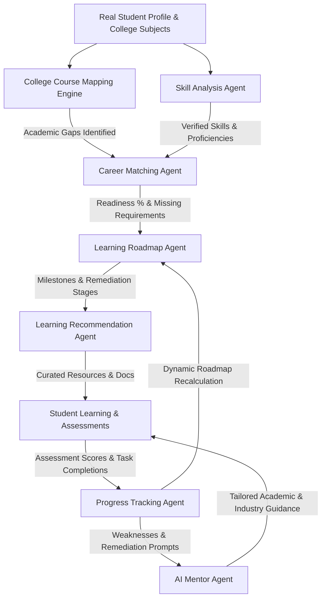

# ORBIT AI – AI CAREERPATH
### Interactive Career Universe & Autonomous Multi-Agent Learning OS
**PromptWars X RTC Hackathon 2026**

---

## 🌟 Executive Overview
**ORBIT AI** is an enterprise-grade AI-powered personalized learning and career navigation platform engineered to eliminate the disconnect between university curricula, individual skill proficiencies, and modern industry demands.

Traditional learning platforms recommend identical, static video playlists to everyone without accounting for verified competencies or academic coursework. **ORBIT AI** transforms career preparation into an **Interactive Career Universe**, deploying **six collaborating AI agents** orchestrated through a central pipeline to answer three fundamental questions:
1. **What skills do I have?**
2. **What skills am I missing?**
3. **What should I learn next?**

---

## 🌌 Design Concept: ORBIT – Interactive Career Universe
- **Editorial Typography**: Bold, oversized headlines in `Space Grotesk`, editorial headings in `Manrope`, high-density interface typography in `Inter`, and monospace data readouts in `JetBrains Mono`.
- **Strict Monochrome Palette**:
  - Pure Black: `#050505`
  - Deep Black: `#101010`
  - Card Background: `#151515`
  - Pure White: `#FFFFFF`
  - Soft White: `#F7F7F7`
  - Light Grey: `#E8E8E8`
  - Borders & Dividers: `#292929`
- **Mixed Dark & White Strategy**:
  - *Landing Hero*: Deep Black with signature interactive Orbital Universe
  - *The Skill Gap Problem*: Editorial Pure White
  - *Core Solution & Three Questions*: Editorial Soft White
  - *Skill Intelligence*: Deep Black
  - *College-to-Industry Mapping*: Editorial Pure White
  - *Multi-Agent Architecture*: Editorial Soft White
  - *AI Mentor Studio*: Deep Black conversational workspace
  - *Real User Onboarding Form*: High-contrast editorial form with zero demo data
  - *Command Center & Skill Universe*: Radial SVG interactive orbital map

---

## 🪐 Signature Features

### 1. Interactive Orbital Skill Universe
- **Radial Gravitational Map**: Concentric orbits representing Foundational Languages (Orbit 1), Specialized Frameworks (Orbit 2), Production & DevOps (Orbit 3), and Career Requirements (Orbit 4).
- **Dynamic Node States**:
  - `✓ Demonstrated`: Verified competencies with solid white glowing highlights.
  - `~ College Mapped`: Foundations covered in college theory requiring industry depth.
  - `! Missing Gap`: High-priority employer requirements absent from current profile.
- **Node Inspection Drawer**: Clicking any node opens diagnostic quiz status, college syllabus alignment, recommended resources, and AI Mentor actions.
- **Pan, Zoom & Orbit Controls**: Real-time auto-rotation, zoom levels (0.75x to 1.4x), and filter modes.

### 2. College-to-Industry Course Mapping Engine (Section 10)
Connects academic coursework directly to employer skill matrices across 3 distinct tiers:
1. **Covered by College**: Subjects natively addressed in university degree courses (e.g., *Data Structures*, *Algorithms*, *DBMS*, *Operating Systems*).
2. **Partially Covered**: Theory taught without production depth (e.g., basic Web Technology, academic Agile).
3. **Industry Skills Not Covered (The Missing Gap)**: Crucial employer competencies (e.g., *Docker*, *Kubernetes*, *REST/GraphQL APIs*, *CI/CD*, *System Architecture*) absent from college curricula.

### 3. Smart Document & Resume Parser
- Supports parsing resume text or college syllabus transcripts.
- Automatically regex-extracts detected technical skills and academic degree programs, merging them directly into the student profile and updating the multi-agent pipeline.

### 4. Six Specialized AI Agents & Central Orchestrator


- **Agent 01 – Skill Analysis Agent**: Quantifies proficiencies, separates strengths from missing gaps.
- **Agent 02 – Career Matching Agent**: Benchmarks profile against 10+ tech roles (Full Stack, AI/ML, Cloud, Data, Security).
- **Agent 03 – Learning Roadmap Agent**: Sequentially plans milestone stages with capstone practical projects.
- **Agent 04 – Learning Recommendation Agent**: Recommends verified documentation (MDN, FastAPI, React, Docker).
- **Agent 05 – AI Mentor Agent**: Context-aware technical coach answering doubts with syllabus and roadmap memory.
- **Agent 06 – Progress Tracking Agent**: Evaluates assessment scores and task completions, adapting roadmaps dynamically.

---

## 🛠️ Technology Stack
- **Backend**: Python 3.14 + FastAPI + SQLite (WAL mode, relational integrity)
- **Security**: JWT (HS256) + bcrypt password hashing + Role-Based Access Control
- **Frontend**: React 18 + Vite + Tailwind CSS + Lucide React + Recharts
- **Visualizations**: Custom SVG-based Orbital Career Universe and concentric agent cluster
- **Dual-Mode AI Engine**: Seamless Google Gemini API integration with instant deterministic heuristic fallback for 100% offline hackathon reliability

---

## 🚀 Quickstart & Setup Instructions

### 1. Requirements
- Python 3.10+
- Node.js 18+

### 2. Environment Configuration
Create a `.env` file in the root directory:
```bash
PORT=8000
HOST=127.0.0.1
SECRET_KEY=orbit-ai-hackathon-secret-jwt-key-2026
GEMINI_API_KEY=your_optional_gemini_api_key_here
```

### 3. Install Dependencies & Build
```powershell
# Backend Dependencies
pip install fastapi uvicorn pydantic pyjwt passlib bcrypt httpx google-generativeai

# Frontend Build
cd frontend
npm install
npm run build
cd ..
```

### 4. Run the Unified Application
```powershell
# Start unified FastAPI server serving both API endpoints and React SPA:
$env:PYTHONPATH = "$PWD\backend"
python -m uvicorn app.main:app --host 127.0.0.1 --port 8000
```
Open **`http://127.0.0.1:8000`** in any browser.

---

## 🧪 Automated Test Verification

Run the complete test suites:
```powershell
# 1. ORBIT AI End-to-End Onboarding & Document Parser Test
python backend/tests/test_orbit_e2e.py

# 2. Full Platform 11-Module Unit Regression Suite
python backend/tests/test_full_platform.py
```
All tests execute against live SQLite records and assert genuine data persistence.

---

## 📜 License
Developed for the **PromptWars X RTC Hackathon 2026**.
